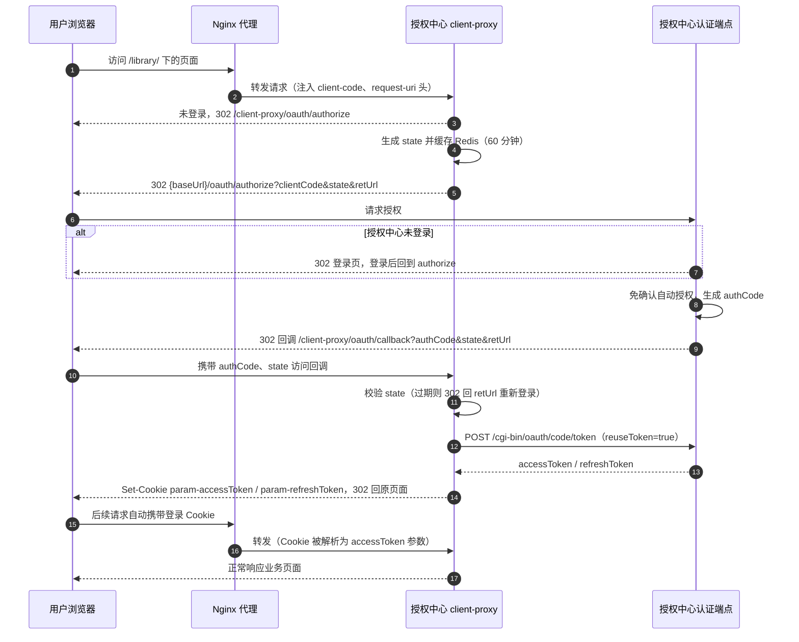
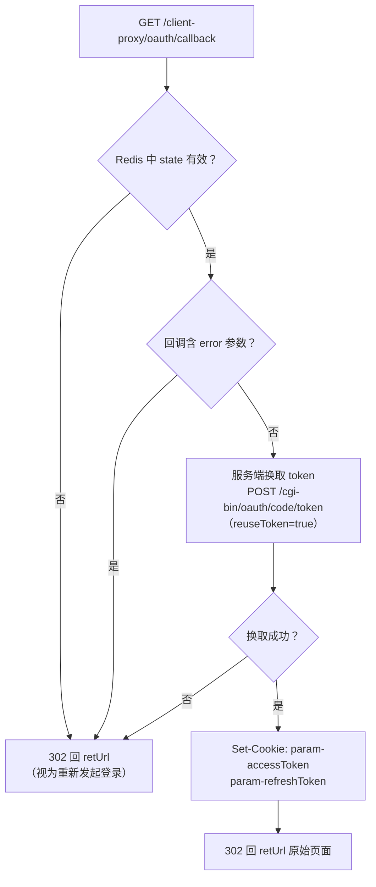

# 第三方系统接入授权中心 OAuth2.0 统一认证对接文档 —— 客户端代理模式

| 项目 | 说明 |
| --- | --- |
| 适用系统 | ucenter.api（micro-platform 统一用户&授权中心） |
| 文档版本 | v1.0 |
| 认证协议 | OAuth2.0 授权码模式（由授权中心内置的客户端代理 client-proxy 代为完成） |
| 适用场景 | 第三方系统**不希望改造前后端代码**，通过 Nginx 将站点代理到授权中心域名下，由代理自动完成登录跳转、code 换 token、Cookie 注入 |
| 接口基地址 | `https://auth.jtxuexi.com`（以部署配置 MY_FRONTEND_URI 为准，下文统一以 `{baseUrl}` 表示） |

---

## 1. 概述

客户端代理模式（client-proxy）是授权码模式的一层"托管实现"。授权中心内置了一个通用 OAuth 客户端（`/client-proxy/*` 路由），配合 Nginx 反向代理，将第三方系统站点挂在授权中心域名下的某个路径访问。登录全流程由代理自动完成：

1. 代理生成 `state` 并 302 到授权中心 `/oauth/authorize`；
2. 用户在授权中心登录后，携带 `authCode` 回调到代理 `/client-proxy/oauth/callback`；
3. 代理在服务端用 authCode 换取 token（`reuseToken=true`，复用授权中心登录会话的 token），并将 `accessToken`/`refreshToken` 写入浏览器 Cookie（`param-accessToken`、`param-refreshToken`）；
4. 浏览器带着 Cookie 回到原始访问页面，第三方系统即可通过这些 Cookie（或网关注入的 `user-info` 头）识别当前用户。

与标准授权码模式的对比：

| 对比项 | 授权码模式（自研对接） | 客户端代理模式 |
| --- | --- | --- |
| 换 token | 第三方后端自行调用 | 授权中心代理自动完成 |
| 登录态维持 | 第三方自管会话 | Cookie `param-accessToken` / `param-refreshToken` |
| 代码改造 | 需要（登录入口+回调） | 几乎不需要 |
| 部署要求 | 无特殊要求 | 必须由 Nginx 代理并注入 `client-code` 头 |

> 一般业务系统**优先推荐标准授权码模式**；本模式适用于遗留系统、静态站点或不便改造代码的场景。

---

## 2. 接入条件与申请

代理模式除注册应用（同标准模式，取得 `clientCode`/`clientSecret`、配置回调 host 白名单）外，还需与授权中心管理员共同确认以下部署参数：

| 配置项 | 说明 |
| --- | --- |
| 代理挂载路径 | 第三方站点在 `{baseUrl}` 下的代理前缀（如 `/library/`） |
| `client-code` | 由 Nginx 按 location 注入的请求头，标识当前代理哪个应用；**缺失或错误时代理直接报错"客户端不存在"** |
| `clientProxy.clients` | 管理员在授权中心侧为该 clientCode 配置的代理参数（baseUrl、clientCode、clientSecret、version）；未配置时自动读取应用注册信息 |
| state 有效期 | 默认 60 分钟（`clientProxy.stateExpiresTime`） |

代理相关固定路径（由授权中心提供，无需第三方实现）：

| 路径 | 用途 |
| --- | --- |
| `/client-proxy/oauth/authorize` | 发起登录跳转 |
| `/client-proxy/oauth/callback` | 接收 authCode，换 token 并写 Cookie |
| `/client-proxy/oauth/sign-in` | 手动注入登录 Cookie |
| `/client-proxy/oauth/sign-out` | 清除登录 Cookie |

---

## 3. 对接流程

### 3.1 时序图



回调处理逻辑：



### 3.2 关键接口说明

#### 发起登录：`GET /client-proxy/oauth/authorize`

- 需携带请求头 `client-code`（Nginx 注入，不应由浏览器伪造传入）；
- 可选头 `request-uri`：Nginx 注入用户原始请求 URI，登录完成后回跳到该地址；缺省时使用回调请求自身的 URL；
- 代理自动生成 state 并 302 跳转到：

```
{baseUrl}/oauth/authorize?clientCode=xxx&state=xxx&schemaCode=xxx&version=xxx&retUrl=<回调地址>
```

其中 `retUrl = {scheme}://{host}/client-proxy/oauth/callback?retUrl=<原始地址>`。

#### 登录回调：`GET /client-proxy/oauth/callback`

| 参数 | 说明 |
| --- | --- |
| state | 授权中心原样回传，代理与 Redis 缓存比对；**state 过期则直接 302 回 retUrl（重新走登录）** |
| authCode | 授权码，代理在服务端换取 token |
| retUrl | 登录完成后最终回跳地址 |
| error / msg | 授权失败时授权中心回传的参数 |

处理结果：`Set-Cookie: param-accessToken`、`param-refreshToken` 后 302 回 `retUrl`。Cookie 的 host 为代理挂载域名，因此后续所有经该 Nginx 的请求都会自动携带。

#### 手动注入登录态：`GET /client-proxy/oauth/sign-in`

| 参数 | 必填 | 说明 |
| --- | --- | --- |
| accessToken | 是 | 已有的用户 accessToken |
| refreshToken | 否 | 配套的 refreshToken |

用于第三方系统已通过其他途径（如标准授权码模式自研对接）取得 token 后，将其注入浏览器 Cookie。

#### 注销：`GET /client-proxy/oauth/sign-out`

清除 `param-accessToken`、`param-refreshToken` Cookie。仅清除当前代理域下登录态；如需**全局统一退出**（退出授权中心及各接入系统），仍需调用 `GET {baseUrl}/oauth/logout?clientCode=xxx&state=xxx&retUrl=xxx`。

### 3.3 第三方系统如何取用户身份

登录完成后，第三方系统可通过以下任一方式识别用户：

1. **Cookie 直读**：请求自动携带 `param-accessToken` Cookie，授权中心及各业务系统统一按 `param-*` 前缀约定将其解析为 `accessToken` 参数；
2. **网关鉴权**：Nginx 对受保护路径配置 `auth_request` 到授权中心 `POST /auth/check`（携带 `param-accesstoken`），校验通过后将响应中的 `userInfo`（base64 JSON）透传为请求头 `user-info`，业务代码解析即得用户信息（userCode、realName、idNum 等）；
3. **回源验证**：调用 `GET {baseUrl}/core/user/cur`（Header `param-accesstoken`）获取当前用户信息并验证 token 有效性。

---

## 4. Nginx 配置示例

以第三方系统"图书馆子系统"挂载到 `/library/` 为例（clientCode 为 `lib-client-001`）：

```nginx
upstream ucenter_api {
    server 127.0.0.1:12001;   # ucenter.api 服务地址
}

server {
    listen 443 ssl;
    server_name auth.jtxuexi.com;

    # 授权中心自身接口与登录页
    location / {
        proxy_pass http://ucenter_api;
        proxy_set_header Host $host;
        proxy_set_header X-Forwarded-Proto $scheme;
    }

    # 第三方系统经 client-proxy 代理接入
    location /library/ {
        proxy_pass http://ucenter_api/;
        proxy_set_header Host $host;
        proxy_set_header X-Forwarded-Proto $scheme;
        proxy_set_header client-code "lib-client-001";   # 注入应用标识
        proxy_set_header request-uri $request_uri;        # 记录原始地址，登录后回跳
    }

    # 可选：未登录时先跳代理登录入口
    location = /library-login {
        return 302 /client-proxy/oauth/authorize;
    }
}
```

要点：

1. `client-code` 头必须注入且不可信任外部传入（防止伪造切换应用）；
2. 第三方应用静态资源、回调后回跳地址都必须位于同一代理前缀下，否则 Cookie 域不匹配导致登录态丢失；
3. 若配置了 `auth_request`，未认证请求应 302 到 `/client-proxy/oauth/authorize`。

---

## 5. 接口清单速查

| 接口 | 方法 | 说明 |
| --- | --- | --- |
| `/client-proxy/oauth/authorize` | GET | 发起登录跳转（需 `client-code` 头） |
| `/client-proxy/oauth/callback` | GET | 接收 authCode，换 token 并写 Cookie |
| `/client-proxy/oauth/sign-in` | GET | 手动注入登录 Cookie |
| `/client-proxy/oauth/sign-out` | GET | 清除登录 Cookie |
| `/oauth/authorize` | GET | （授权中心）客户端请求授权 |
| `/oauth/logout` | GET | （授权中心）统一退出登录 |
| `/cgi-bin/oauth/code/token` | POST | （代理内部使用）授权码换 token |
| `/core/user/cur` | GET | 当前用户信息/验证 token |
| `/auth/check` | POST | 网关鉴权（auth_request 场景） |

---

## 6. 错误码表

代理流程最终透传授权中心授权码模式的错误（回调 URL 中以 `error`/`msg` 参数体现），换 token 阶段错误码：

| code | msg | 常见场景与处理 |
| --- | --- | --- |
| 0 | 成功 | — |
| 1001 | 缺少应用标识 | `client-code` 头未注入或代理配置缺失 |
| 1003 | 应用不存在 | clientCode 错误 |
| 1004 | 应用已禁用 | 联系管理员启用应用 |
| 1005 | 回调地址错误 | 代理回调 host 未加入应用 retUrls 白名单 |
| 1007 | 应用秘钥无效 | clientSecret 错误（管理员核对代理配置） |
| 1009 | 授权码无效 | state 过期后重新回调、authCode 已被消费 |
| 4002 | token 无效 | Cookie 中 accessToken 过期，重新登录 |
| 6000 | 没有进行此项操作的权限 | 检查应用 scopes / modulePrivCodes |

> 代理请求（`/client-proxy/*`）缺少或传了错误的 `client-code` 头时，返回 HTTP 500，msg 为"客户端不存在，请检查访问路径是否正确"。

---

## 7. 安全要求与注意事项

1. `client-code` 请求头只能由 Nginx 注入，Nginx 层应覆盖/剥离外部同名头，防止伪造切换应用。
2. state 有效期 60 分钟；过期后回调会静默 302 回原页面重新走登录，属正常行为，无需报警。
3. 代理换 token 使用 `reuseToken=true`，即第三方站点与授权中心共享同一 token 会话——**同一浏览器域下所有经此代理的应用互为单点登录**，注销必须走 `/oauth/logout` 全局退出，仅 `/client-proxy/oauth/sign-out` 不会退出授权中心会话。
4. `param-accessToken`/`param-refreshToken` 存储在浏览器 Cookie 中，代理挂载域（auth 域名）下的所有应用均可见，请确认同域代理的应用均经过安全评估。
5. 生产环境请全站 HTTPS；`clientSecret` 仅存在于授权中心服务端配置，不下发到第三方。
6. 本模式依赖路径前缀代理，第三方站点内的绝对路径（`/xxx`）需改为相对路径或在 Nginx 层改写（`sub_filter`/`proxy_redirect`），否则登录后回跳与静态资源会跳出代理前缀导致登录态丢失。
