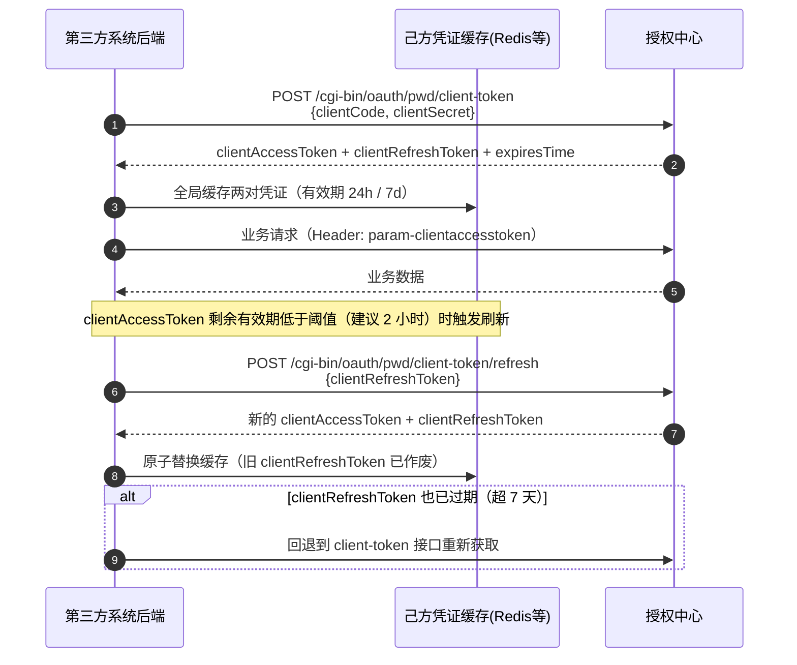
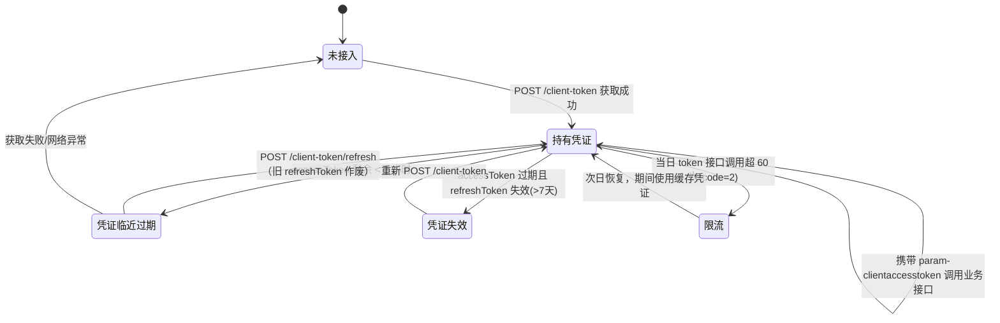

# 第三方系统接入授权中心 OAuth2.0 统一认证对接文档 —— 客户端凭证模式

| 项目 | 说明 |
| --- | --- |
| 适用系统 | ucenter.api（micro-platform 统一用户&授权中心） |
| 文档版本 | v1.0 |
| 认证协议 | OAuth2.0 客户端凭证模式（client credentials，本平台以密码模式端点形式提供） |
| 适用场景 | 无最终用户参与、以"应用身份"进行的服务端之间 API 调用（数据同步、后台任务、定时批量接口等） |
| 接口基地址 | `https://auth.jtxuexi.com`（以部署配置 MY_FRONTEND_URI 为准，下文统一以 `{baseUrl}` 表示） |
| 在线 API 文档 | `{baseUrl}/documentation`（Swagger UI）/ `{baseUrl}/reference`（Scalar，仅调试环境开放） |

---

## 1. 概述

客户端凭证模式用于第三方系统**后台服务**以自身应用身份（`clientCode` + `clientSecret`）获取应用级访问凭证 `clientAccessToken`，不涉及具体登录用户，也不返回用户身份信息。

核心角色：

| 角色 | 说明 |
| --- | --- |
| 授权中心（Authorization Server） | ucenter.api，负责签发/校验 clientToken |
| 接入应用（Client） | 第三方系统后台，以 `clientCode` + `clientSecret` 标识 |
| 资源接口（Resource Server） | 授权中心及各业务系统，凭 `clientAccessToken` 识别调用方应用并做权限判定 |

统一响应格式：

```json
{
    "code": 0,
    "msg": "成功",
    "data": { },
    "statusCode": 200
}
```

`code = 0` 成功；非 0 失败，见第 6 节错误码表。

---

## 2. 接入申请

向授权中心管理员申请注册应用，获得以下凭据与配置：

| 配置项 | 说明 |
| --- | --- |
| `clientCode` | 应用唯一标识 |
| `clientSecret` | 应用密钥，**仅允许保存在第三方后端** |
| `status` | 应用状态：0 启用、1 禁用（禁用应用获取 token 返回 1004） |
| `modulePrivCodes` | 应用模块权限标识，决定该应用可调用哪些服务端接口 |

凭据有效期与频控（服务端默认配置，以部署环境为准）：

| 凭据/限制 | 默认值 | 说明 |
| --- | --- | --- |
| clientAccessToken | 24 小时 | 应用级访问凭证 |
| clientRefreshToken | 7 天 | 换取新凭证后旧的作废 |
| token 接口调用频控 | **60 次/日/应用** | 获取与刷新共用计数，超限返回 `code=2` |

> **重要**：token 接口有严格的每日调用次数限制，接入方**必须**在己方服务端（如 Redis/本地缓存）全局缓存 clientAccessToken 并按 `expiresTime` 提前刷新，严禁每次业务请求都调用 token 接口。

---

## 3. 对接流程



凭证生命周期状态：



### 3.1 获取 clientToken

**接口**：`POST {baseUrl}/cgi-bin/oauth/pwd/client-token`
**Content-Type**：`application/json`

| 参数 | 类型 | 必填 | 说明 |
| --- | --- | --- | --- |
| clientCode | string | 是 | 应用标识 |
| clientSecret | string | 是 | 应用密钥 |

**成功响应示例**：

```json
{
    "code": 0,
    "data": {
        "clientAccessToken": "06594bb1-xxxx-xxxx-xxxx-xxxxxxxxxxxx",
        "clientRefreshToken": "06594bb1-xxxx-xxxx-xxxx-xxxxxxxxxxxx",
        "expiresTime": 86400000
    }
}
```

- `expiresTime`：clientAccessToken 有效时长，单位**毫秒**。
- 失败场景：应用不存在 `1003`、应用已禁用 `1004`、秘钥错误 `1007`、超频控 `2`。

### 3.2 刷新 clientToken

**接口**：`POST {baseUrl}/cgi-bin/oauth/pwd/client-token/refresh`
**Content-Type**：`application/json`

| 参数 | 类型 | 必填 | 说明 |
| --- | --- | --- | --- |
| clientRefreshToken | string | 是 | 上一步获取的刷新凭证 |

**响应**：同 3.1。刷新成功后**旧 clientRefreshToken 立即作废**，必须用返回值整体替换本地缓存的两项凭证。

建议在 clientAccessToken 剩余有效期不足阈值（如 2 小时）时主动刷新；若 clientRefreshToken 也已过期（7 天），回退到 3.1 重新获取。

### 3.3 调用业务接口

请求业务接口时在 HTTP Header 中携带：

```
param-clientaccesstoken: {clientAccessToken}
```

授权中心网关鉴权接口 `POST {baseUrl}/auth/check`（`{path, method}` + 上述 Header）会解析应用身份并按 `modulePrivCodes` 判定权限：

- 校验通过：`data.clientInfo` 返回应用信息（base64 编码 JSON，不含 clientSecret，附 `privs` 权限列表），网关可透传为下游请求头 `client-info`；
- token 无效返回 `4002`；应用无该接口权限返回 `6000`。

> 参数命名约定：Header/Cookie 名以 `param-` 前缀携带，解析时 `param-clientaccesstoken` 映射为 `clientAccessToken`、`param-accesstoken` 映射为 `accessToken`（Query/Body 直接使用驼峰原名亦可）。

---

## 4. 对接示例（curl）

```bash
# 1. 获取 clientToken
curl -X POST '{baseUrl}/cgi-bin/oauth/pwd/client-token' \
  -H 'Content-Type: application/json' \
  -d '{
    "clientCode": "your-client-code",
    "clientSecret": "your-client-secret"
  }'

# 2. 以应用身份调用业务接口
curl '{baseUrl}/core/user/list' \
  -H 'param-clientaccesstoken: {clientAccessToken}' \
  -H 'Content-Type: application/json' \
  -d '{"pageIndex":1,"pageSize":20}'

# 3. 刷新 clientToken
curl -X POST '{baseUrl}/cgi-bin/oauth/pwd/client-token/refresh' \
  -H 'Content-Type: application/json' \
  -d '{"clientRefreshToken": "{clientRefreshToken}"}'
```

---

## 5. 接口清单速查

| 接口 | 方法 | 说明 |
| --- | --- | --- |
| `/cgi-bin/oauth/pwd/client-token` | POST | 获取应用级 clientToken |
| `/cgi-bin/oauth/pwd/client-token/refresh` | POST | 刷新应用级 clientToken |
| `/auth/check` | POST | 网关鉴权（auth_request 场景） |

---

## 6. 错误码表

| code | msg | 常见场景与处理 |
| --- | --- | --- |
| 0 | 成功 | — |
| 1 / 1000 | 参数不全 | 检查必填参数 |
| 2 | 操作过于频繁 | token 接口超每日频控（默认 60 次/日），改用缓存并降低刷新频率 |
| -1 | 服务器异常 | 见响应 msg |
| -99 | 未知错误 | 联系授权中心管理员 |
| 1003 | 应用不存在 | clientCode 错误 |
| 1004 | 应用已禁用 | 联系管理员启用应用 |
| 1006 | 缺少应用秘钥 | 未传 clientSecret |
| 1007 | 应用秘钥无效 | clientSecret 错误 |
| 4001 | 缺少 token | 请求未携带 param-clientaccesstoken |
| 4002 | token 无效 | clientAccessToken 过期或已注销，重新获取/刷新 |
| 6000 | 没有进行此项操作的权限 | 检查应用 modulePrivCodes 权限配置 |

---

## 7. 安全要求与注意事项

1. **clientSecret 只允许保存在第三方系统服务端**，严禁出现在前端代码、URL 或日志中。
2. clientAccessToken 必须全局缓存复用，按 `expiresTime` 提前刷新；token 接口每日频控（默认 60 次）以应用为粒度，多实例部署时缓存应集中（如共用 Redis），避免各实例独立取 token 触发限流。
3. 刷新凭证为一次性语义：刷新成功后旧 clientRefreshToken 立即失效，须原子替换本地缓存。
4. clientToken 不代表任何用户身份，仅用于应用级接口；涉及用户登录态的场景请使用《授权码模式》文档。
5. 应用可调用哪些服务端接口由管理员配置的 `modulePrivCodes` 决定，新增接口权限需求请联系管理员。
6. 生产环境请全站 HTTPS；`clientSecret` 泄露时应立即联系管理员重置。
