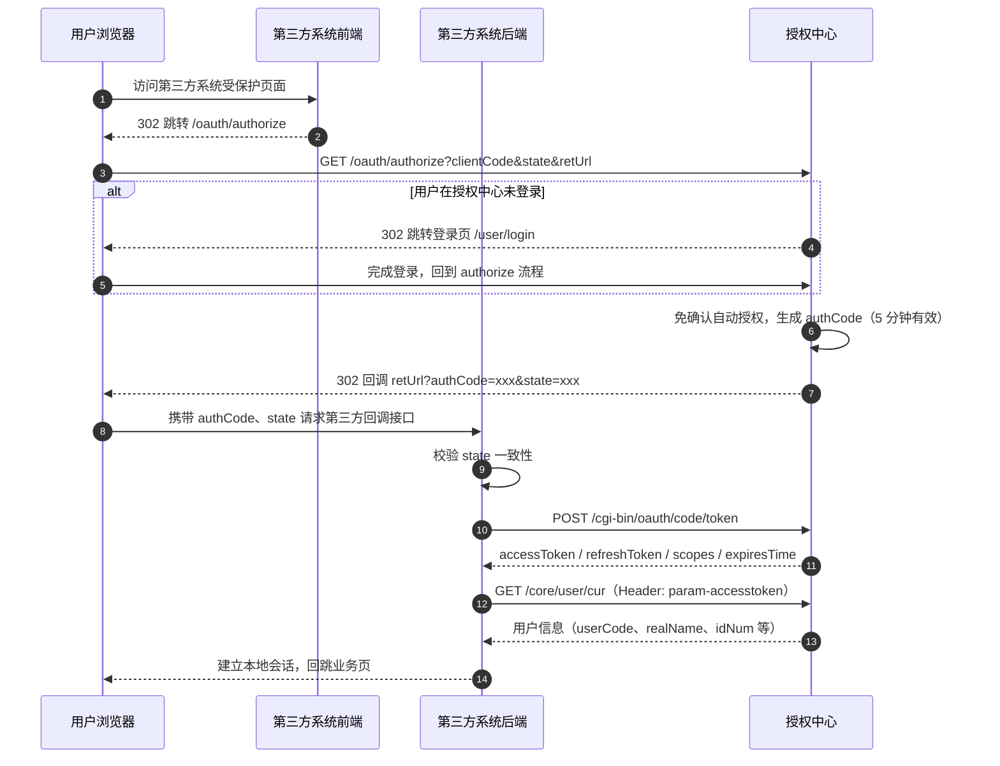
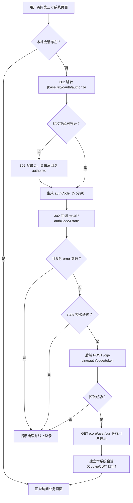
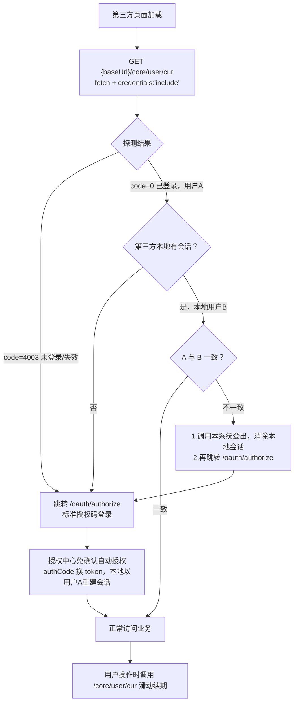

# 第三方系统接入授权中心 OAuth2.0 统一认证对接文档 —— 授权码模式

| 项目 | 说明 |
| --- | --- |
| 适用系统 | ucenter.api（micro-platform 统一用户&授权中心） |
| 文档版本 | v1.0 |
| 认证协议 | OAuth2.0 授权码模式（authorization code） |
| 适用场景 | 面向最终用户的单点登录（SSO），第三方系统获取登录用户身份与信息 |
| 接口基地址 | `https://auth.jtxuexi.com`（以部署配置 MY_FRONTEND_URI 为准，下文统一以 `{baseUrl}` 表示） |
| 在线 API 文档 | `{baseUrl}/documentation`（Swagger UI）/ `{baseUrl}/reference`（Scalar，仅调试环境开放） |

---

## 1. 概述

授权中心为全校业务系统提供统一身份认证（SSO）能力。授权码模式为标准推荐方案：用户在授权中心完成登录后，授权中心 302 回调第三方系统并携带一次性授权码（authCode），第三方系统**后端**凭 authCode + clientSecret 换取用户级 `accessToken`/`refreshToken`，进而获取用户信息、建立本地会话。

核心角色：

| 角色 | 说明 |
| --- | --- |
| 授权中心（Authorization Server） | ucenter.api，负责登录、授权、签发/校验 token |
| 接入应用（Client） | 第三方系统，以 `clientCode` + `clientSecret` 标识 |
| 资源接口（Resource Server） | 授权中心及各业务系统，凭 `accessToken` 识别当前用户 |

统一响应格式（浏览器跳转类接口除外）：

```json
{
    "code": 0,
    "msg": "成功",
    "data": { },
    "statusCode": 200
}
```

`code = 0` 成功；非 0 失败，见第 7 节错误码表。

---

## 2. 接入申请

第三方系统接入前，需向授权中心管理员申请注册应用，获得以下凭据与配置：

| 配置项 | 说明 |
| --- | --- |
| `clientCode` | 应用唯一标识 |
| `clientSecret` | 应用密钥，**仅限第三方后端使用，严禁下发到浏览器/移动端** |
| `retUrls` | 回调地址白名单。授权中心按 **host**（含端口）校验，回调地址的 host 必须在白名单内 |
| `grantTypes` | 需包含 `code` |
| `scopes` | 授权范围：`myRead`（读取个人基本信息）、`myWrite`（修改个人基本信息）、`admin`（后台管理），默认 `myRead` |
| `status` | 应用状态：0 启用、1 禁用 |

token 有效期（服务端默认配置，以部署环境为准）：

| 凭据 | 默认有效期 | 说明 |
| --- | --- | --- |
| authCode 授权码 | 5 分钟 | 一次性使用 |
| state 防重放标识 | 60 分钟 | 建议第三方自行生成并校验 |
| accessToken | 24 小时 | 校验通过时自动滑动续期 |
| refreshToken | 30 天 | 换取新 token 后旧 refreshToken 作废 |

---

## 3. 对接流程

### 3.1 时序图



整体登录判定流程：



### 3.2 第一步：引导用户请求授权

**接口**：`GET {baseUrl}/oauth/authorize`

| 参数 | 位置 | 必填 | 说明 |
| --- | --- | --- | --- |
| clientCode | query | 是 | 应用标识 |
| state | query | 是 | 第三方自定义随机串，回调时原样返回，用于防 CSRF/校验会话 |
| retUrl | query | 是 | 授权完成后的回调地址（URL 编码），host 须在白名单内 |
| scopes | query | 否 | 申请的授权范围，逗号分隔，只能缩小应用已配置的 scopes |
| version | query | 否 | 登录界面版本（如 `v1`） |
| schemaCode | query | 否 | 使用模式（界面方案编码） |

处理逻辑：

1. 校验应用存在、启用、回调地址 host 在白名单内；
2. 若用户在授权中心**未登录**：302 跳转 `{baseUrl}/user/login?retUrl=<本authorize地址>`，登录成功后回到 authorize 流程；
3. 若已登录：**免用户确认自动授权**，生成 authCode（有效期 5 分钟）；
4. 302 重定向回调：

```
{retUrl}?authCode={授权码}&state={原样返回}
```

5. 授权出错时 302 重定向：`{retUrl}?error={错误码}&msg={错误信息}`，第三方系统必须处理该分支。

### 3.3 第二步：后端用 authCode 换取 token

**接口**：`POST {baseUrl}/cgi-bin/oauth/code/token`
**Content-Type**：`application/json`

| 参数 | 类型 | 必填 | 说明 |
| --- | --- | --- | --- |
| clientCode | string | 是 | 应用标识 |
| clientSecret | string | 是 | 应用密钥 |
| authCode | string | 是 | 上一步获取的授权码 |
| retUrl | string | 是 | **必须与第一步传入的 retUrl 完全一致**（逐字比较） |
| reuseToken | boolean | 否 | 为 `true` 时复用授权中心登录会话的 token（仅客户端代理模式使用），一般对接方不传 |

**成功响应示例**：

```json
{
    "code": 0,
    "data": {
        "accessToken": "userCode:xxxxxxxx-xxxx-xxxx-xxxx-xxxxxxxxxxxx",
        "refreshToken": "userCode:xxxxxxxx-xxxx-xxxx-xxxx-xxxxxxxxxxxx",
        "scopes": ["myRead"],
        "expiresTime": 86400000
    }
}
```

- `expiresTime`：accessToken 剩余有效时长，单位**毫秒**。
- 校验失败返回 `1005/1007/1009` 等错误码，见错误码表。

### 3.4 第三步：获取用户信息、建立本地会话

第三方后端持 `accessToken` 调用用户信息接口，成功后在**本系统**建立会话（Cookie/JWT 由对接方自管），此后无需每步回源授权中心。

**接口**：`GET {baseUrl}/core/user/cur`（可通过此接口验证 token 是否有效）

accessToken 支持三种传递方式（任选其一）：

| 方式 | 写法 |
| --- | --- |
| HTTP Header | `param-accesstoken: {accessToken}` |
| Cookie | `param-accessToken={accessToken}` |
| Query/Body | `accessToken={accessToken}` |

**成功响应示例（data 为主要字段，节选）**：

```json
{
    "code": 0,
    "data": {
        "userCode": "xxxxxxxx",
        "loginName": "zhangsan",
        "realName": "张三",
        "nickName": "...",
        "avatarUrl": "...",
        "mobile": "138xxxxxxxx",
        "email": "...",
        "gender": 1,
        "idNum": "学号/工号",
        "orgCodes": ["..."],
        "departments": [],
        "collegeCode": "...", "collegeName": "...",
        "specialtyCode": "...", "specialtyName": "...",
        "grade": "...",
        "privs": []
    }
}
```

> 第三方系统建议以 `userCode` 作为本系统的用户唯一标识，`idNum`（学号/工号）作为业务主键映射。密码、大字段不会返回。

### 3.5 token 刷新

accessToken 过期（且滑动续期失效）后，用 refreshToken 换取整套新 token：

**接口**：`POST {baseUrl}/core/user/auth/token/refresh`

| 参数 | 类型 | 必填 |
| --- | --- | --- |
| refreshToken | string | 是 |

**响应**：`data` 返回新的 accessToken、refreshToken 及用户信息（UserInfoWithToken）。

> 注意：刷新成功后**旧 refreshToken 即失效**（一次性），必须用返回值整体替换本地存储。

### 3.6 统一退出登录

**接口**：`GET {baseUrl}/oauth/logout`

| 参数 | 必填 | 说明 |
| --- | --- | --- |
| clientCode | 是 | 应用标识 |
| state | 是 | 随机串 |
| retUrl | 是 | 退出后的回跳地址（URL 编码） |
| version / loginType / schemaCode | 否 | 登录界面参数 |

处理逻辑：清理授权中心登录态后，会以重新登录方式回跳授权流程；第三方系统应同时**销毁本系统会话**。

### 3.7 网关鉴权对接（可选，Nginx auth_request 模式）

授权中心提供统一鉴权接口 `POST {baseUrl}/auth/check`，供业务系统网关校验请求中的 token：

| 参数 | 类型 | 必填 | 说明 |
| --- | --- | --- | --- |
| path | string | 是 | 被访问的接口路径 |
| method | string | 是 | 请求方法 |
| accessToken | 同 3.4 三种传参方式 | 视接口要求 | 待校验的 token |
| no-redirect | boolean | 否 | token 无效时返回 4003（不跳转登录）而非 4002 |

**成功响应**：

```json
{
    "code": 0,
    "data": {
        "userInfo": "<用户信息JSON的base64编码>",
        "clientInfo": "<应用信息JSON的base64编码>"
    }
}
```

网关可将 `userInfo` 透传为下游请求头 `user-info`（base64），业务系统直接解析使用。token 无效返回 `4002`，无权限返回 `6000`。

### 3.8 前端直连模式：登录态探测与账号一致性处理

适用场景：第三方前端在页面加载时**直接跨域调用授权中心接口**探测登录态；当"授权中心登录用户 ≠ 第三方本地会话用户"时，以**授权中心为准**——先退出本地会话，再重新走授权码流程。



关键说明：

1. **以授权中心为准，无死循环**：不一致时丢弃本地会话，重新授权得到的是授权中心当前用户 A，本地重建为 A 的会话，下次探测即一致。若产品语义是"保留本地用户 B、让用户去授权中心切回 B"，本模式不适用——需先走 `GET /oauth/logout` 全局登出（会影响该浏览器在所有 SSO 系统的登录态）再让用户重新登录授权中心。
2. **探测接口前提**：
   - 第三方前端域名（Origin）须加入授权中心 `allowedOrigins` CORS 白名单（联系管理员配置），请求必须携带 `credentials:'include'`；
   - **同主域说明**：浏览器"同站点（same-site）"按 **协议 + 主域（eTLD+1，即可注册域名）** 判定，授权中心登录 Cookie 默认 `SameSite=Lax`，只有 same-site 请求才会自动携带：
     - ✅ 同主域：`https://app.example.com` 与 `https://auth.example.com`（主域同为 `example.com`）——跨 Origin 但同站点，fetch 可携带 Lax Cookie，探测有效；子域层级再深（如 `a.b.example.com`）也属同站点；
     - ❌ 跨主域：`https://your-app.com` 与 `https://auth.example.com`——即使 CORS 白名单放行，Cookie 也不发送，探测恒返回 `4003`；
     - ❌ 协议不同：`http://app.example.com` 与 `https://auth.example.com`——协议参与站点判定，不算同主域；
     - 本地联调时 `localhost`/`127.0.0.1` 与线上授权域、不同后缀域名（如 `xxx.edu.cn` 对 `xxx.com`）均**不是**同主域，勿以本地探测结果推断线上行为；
   - 探测仅在第三方与授权中心**同主域且同协议**时可靠。**跨主域部署不要使用前端探测**（JSONP 同理不可行：脚本子资源同样不携带 Lax Cookie），应直接走主流程"顶层跳转 `/oauth/authorize` + 后端换取 token 后比对 `userCode`"，该路径属顶层导航，Lax Cookie 正常发送，不受第三方 Cookie 限制影响；
   - 结果判定：`code=0` 已登录（比对 `data.userCode`），`code=4003` 未登录或 token 失效。
3. **顺序不可颠倒**：必须先完成本系统登出（服务端销毁会话、清 Cookie），再跳转 authorize；否则回跳后旧本地会话会与新用户再次比对不一致。
4. **操作续期（滑动过期）**：用户在第三方系统内有操作时调用 `GET {baseUrl}/core/user/cur`（可节流，如每 5 分钟一次）即可延续授权中心会话——授权中心校验 token 时自动重置 Redis TTL 为 24 小时，**无需专门续期接口**。
   - 标准换 token（不传 `reuseToken`）时，第三方 token 与授权中心会话 token 是两份凭证：前端探测/续期的是**会话 token**，第三方后端携带自己 accessToken 调用时延长的是**该 token**；
   - 若需要两者同步续期，可在换取 token 时传 `reuseToken:true`，与授权中心会话共用同一 token。

---

## 4. 对接示例

前端跳转（第一步）：

```js
// 第三方系统登录入口
const state = crypto.randomUUID();
sessionStorage.setItem('oauth_state', state);
const retUrl = encodeURIComponent('https://your-app.example.com/sso/callback');
location.href = `https://auth.jtxuexi.com/oauth/authorize`
  + `?clientCode=your-client-code&state=${state}&retUrl=${retUrl}`;

// /sso/callback 处理函数
// 1) 检查 location.search 是否含 error 参数，有则提示并终止
// 2) 校验返回的 state 与 sessionStorage 中一致
// 3) 取 authCode 提交给自己的后端换 token（切勿在前端使用 clientSecret）
```

后端接口调用（curl）：

```bash
# 1. 换取token（假设已从回调拿到 authCode）
curl -X POST '{baseUrl}/cgi-bin/oauth/code/token' \
  -H 'Content-Type: application/json' \
  -d '{
    "clientCode": "your-client-code",
    "clientSecret": "your-client-secret",
    "authCode": "userCode:xxxx-xxxx",
    "retUrl": "https://your-app.example.com/sso/callback"
  }'

# 2. 获取当前用户信息
curl '{baseUrl}/core/user/cur' \
  -H 'param-accesstoken: {accessToken}'
```

---

## 5. 接口清单速查

| 接口 | 方法 | 说明 |
| --- | --- | --- |
| `/oauth/authorize` | GET | 客户端请求授权（浏览器 302 流程） |
| `/oauth/logout` | GET | 统一退出登录（浏览器 302 流程） |
| `/cgi-bin/oauth/code/token` | POST | 授权码换 accessToken/refreshToken |
| `/core/user/cur` | GET | 当前登录用户信息（可验证 token 有效性） |
| `/core/user/auth/token/refresh` | POST | refreshToken 换新 token |
| `/auth/check` | POST | 网关鉴权（auth_request 场景） |
| `/core/user/auth/rsa-public-key` | GET | 获取密码加密 RSA 公钥 |

---

## 6. 安全要求与注意事项

1. **clientSecret 只允许保存在第三方系统服务端**，任何情况下不得出现在前端代码、URL 或日志中。
2. authCode、state 均为一次性/短时效凭据：authCode 5 分钟内有效且换取 token 后应视为已消费；回调处理必须校验 `state` 防 CSRF。
3. 回调接口 `/sso/callback` 收到 `error` 参数时必须提示用户并终止登录，不得静默重试造成循环跳转。
4. 授权中心**免用户确认自动授权**：用户在授权中心已登录时，访问 authorize 会直接回跳，第三方页面应避免无意识发起授权请求。
5. 换 token 时 `retUrl` 必须与授权时**逐字一致**，建议回调处理时直接使用授权时记录的地址，而非重新拼接。
6. token 传输建议仅使用 Header（`param-accesstoken`），避免 Query 方式被记录进 Nginx/浏览器历史日志。
7. 必须支持 refreshToken 一次性 semantics：刷新成功后立即替换本地保存的 refreshToken。
8. 授权中心按 `retUrls` host 白名单校验回调地址；更换域名、增加测试环境需提前联系管理员更新配置。
9. 生产环境请全站 HTTPS；`clientSecret` 泄露时应立即联系管理员重置。

---

## 7. 错误码表

| code | msg | 常见场景与处理 |
| --- | --- | --- |
| 0 | 成功 | — |
| 1 / 1000 | 参数不全 | 检查必填参数 |
| -1 | 服务器异常 | 见响应 msg |
| -99 | 未知错误 | 联系授权中心管理员 |
| 1001 | 缺少应用标识 | authorize 未传 clientCode |
| 1002 | 缺少回调地址 | authorize 未传 retUrl |
| 1003 | 应用不存在 | clientCode 错误 |
| 1004 | 应用已禁用 | 联系管理员启用应用 |
| 1005 | 回调地址错误 | retUrl host 不在白名单，或换 token 时 retUrl 与授权时不一致 |
| 1006 | 缺少应用秘钥 | 未传 clientSecret |
| 1007 | 应用秘钥无效 | clientSecret 错误 |
| 1008 | 缺少授权码 | 未传 authCode |
| 1009 | 授权码无效 | authCode 已过期（5 分钟）或已使用 |
| 4001 | 缺少 token | 请求未携带 accessToken |
| 4002 / 4003 | token 无效 | accessToken 过期/被注销，走重新授权或 refresh |
| 6000 | 没有进行此项操作的权限 | 检查应用 scopes 配置 |
